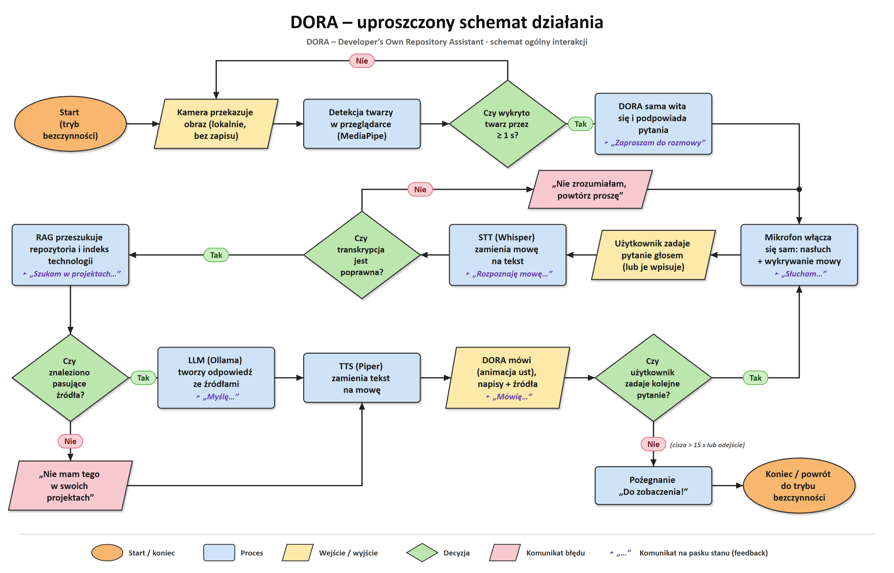
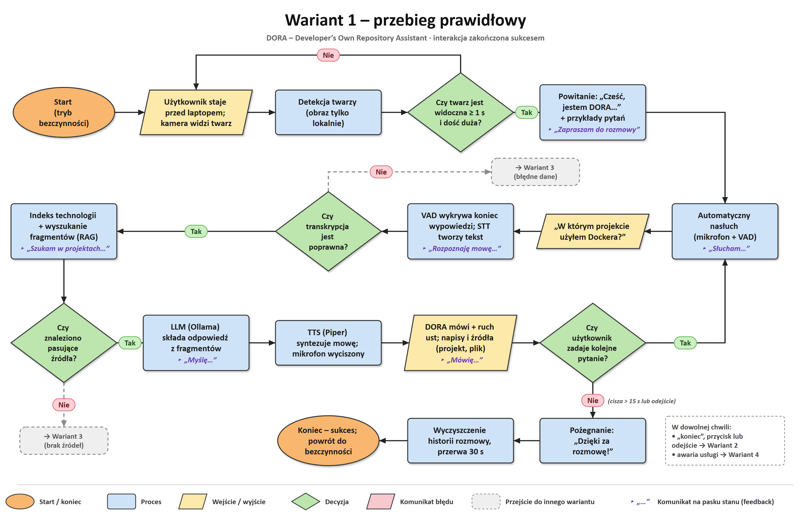
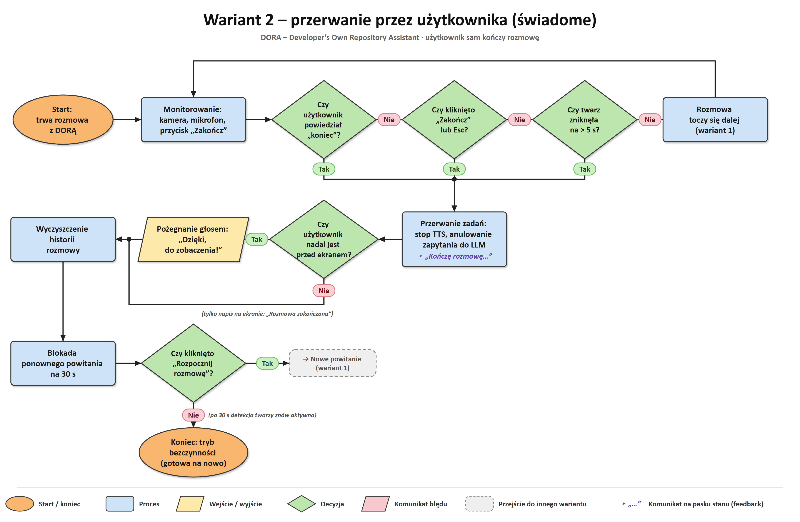
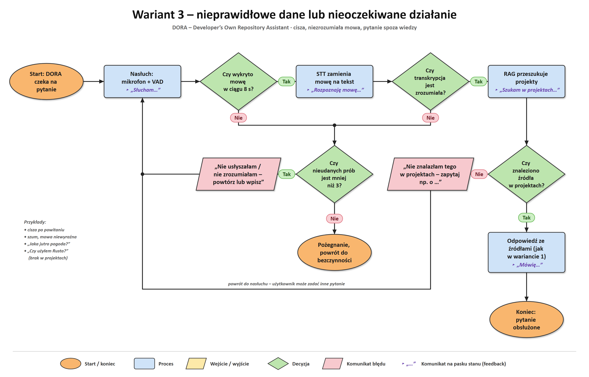
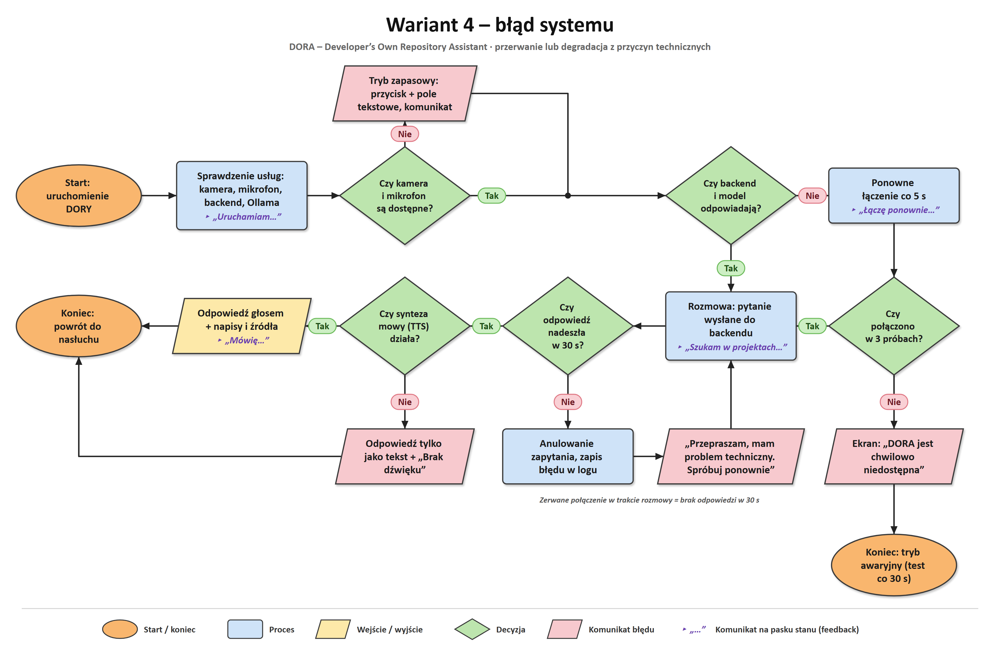

# DORA – schematy blokowe interakcji

**DORA (Developer's Own Repository Assistant)** to lokalny asystent AI z awatarem 2D. Zna portfolio projektów programistycznych autora: odpowiada na pytania o ich budowę i działanie oraz wskazuje, w którym projekcie użyto danej technologii. Wszystko działa na laptopie, bez chmury: model językowy w Ollamie, wyszukiwanie RAG w lokalnych repozytoriach, rozpoznawanie mowy Whisper, synteza mowy Piper i detekcja twarzy MediaPipe w przeglądarce. Rozmowa odbywa się bez użycia rąk: DORA sama zauważa użytkownika, wita się i słucha. Przycisk i pole tekstowe są tylko zapasem.

## Oznaczenia na schematach

| Symbol | Znaczenie |
|---|---|
| Owal (pomarańczowy) | Start / koniec |
| Prostokąt (niebieski) | Proces – operacja wykonywana przez system |
| Równoległobok (żółty) | Wejście / wyjście – dane od użytkownika lub odpowiedź dla niego |
| Równoległobok (różowy) | Wyjście – komunikat o błędzie lub ostrzeżenie |
| Romb (zielony) | Decyzja, wyjścia oznaczone „Tak” / „Nie” |
| Prostokąt przerywany (szary) | Przejście do innego wariantu |
| ▸ „…” (fioletowy tekst) | Komunikat na pasku stanu, czyli informacja zwrotna dla użytkownika |
| Czarna kropka | Połączenie dwóch ścieżek w jedną |

---

## Schemat ogólny

1. **Rozpoczęcie interakcji.** DORA czeka w trybie bezczynności z animacją oddychania i mrugania. Kamera działa cały czas, a obraz jest analizowany tylko w przeglądarce i nigdzie nie zapisywany. Gdy twarz jest widoczna przez co najmniej 1 s i jest dość duża w kadrze, DORA sama zaczyna rozmowę. Użytkownik nie musi niczego naciskać.
2. **Dane wejściowe.** Użytkownik zadaje pytanie głosem, np. „W którym projekcie użyłem Dockera?”, albo wpisuje je w pole tekstowe. Drugim wejściem jest sama obecność twarzy przed kamerą.
3. **Przetwarzanie danych.** Kolejno:
   1. wykrywanie mowy (VAD) rozpoznaje koniec wypowiedzi;
   2. STT zamienia mowę na tekst;
   3. RAG przeszukuje repozytoria i indeks technologii;
   4. LLM tworzy odpowiedź ze wskazaniem źródeł;
   5. TTS zamienia ją na mowę.
4. **Warunki decyzyjne.** System sprawdza:
   - czy wykryto twarz (jeśli nie, dalej czeka);
   - czy transkrypcja jest poprawna (jeśli nie, prosi o powtórzenie);
   - czy znaleziono źródła (jeśli nie, mówi wprost, że nie wie, zamiast zmyślać);
   - czy pada kolejne pytanie (jeśli tak, wraca do nasłuchu; jeśli nie, żegna się).
5. **Informacja zwrotna.** Użytkownik dostaje ją na kilka sposobów:
   - pasek stanu pokazuje komunikaty: „Słucham…”, „Rozpoznaję mowę…”, „Szukam w projektach…”, „Myślę…”, „Mówię…”;
   - awatar zmienia animację w zależności od stanu;
   - rozpoznany tekst pytania pojawia się na ekranie;
   - odpowiedź jest wyświetlana jako napisy razem ze źródłami (projekt, plik);
   - błędy są sygnalizowane komunikatami głosowymi i tekstowymi.
6. **Zakończenie interakcji.** Wynikiem jest odpowiedź głosowa i tekstowa ze źródłami. Po ciszy dłuższej niż 15 s lub odejściu użytkownika DORA się żegna i wraca do bezczynności. Proces można rozpocząć ponownie, po prostu stając przed kamerą.

### Walidacja i scenariusze skrajne

**Obsługa błędów, czyli gdzie interakcja może zostać przerwana:**

| Miejsce | Problem | Reakcja systemu |
|---|---|---|
| Start aplikacji | brak kamery lub mikrofonu | tryb zapasowy z przyciskiem i polem tekstowym, komunikat na ekranie (W4) |
| Nasłuch | cisza, szum, niewyraźna mowa | prośba o powtórzenie; po 3 nieudanych próbach pożegnanie (W3) |
| Wyszukiwanie | pytanie spoza wiedzy lub brak danych | uczciwe „nie znalazłam tego w projektach” i przykłady pytań (W3) |
| Backend / model | brak połączenia | ponowne łączenie co 5 s; po 3 próbach ekran „DORA jest chwilowo niedostępna” (W4) |
| Generowanie | brak odpowiedzi w 30 s | anulowanie zapytania, zapis w logu, przeprosiny i zachęta do ponownej próby (W4) |
| Synteza mowy | TTS nie działa | odpowiedź wyświetlona tylko jako tekst (W4) |
| Dowolny moment | użytkownik mówi „koniec”, klika „Zakończ” lub odchodzi | przerwanie zadań, pożegnanie, powrót do bezczynności (W2) |

**Alternatywne ścieżki:**

- **Użytkownik woli pisać niż mówić.** Pytanie z pola tekstowego pomija STT i od razu trafia do wyszukiwania.
- **Użytkownik na chwilę się odwraca.** Próg 5 s sprawia, że DORA nie żegna się przy każdym ruchu głowy.
- **Użytkownik wraca zaraz po pożegnaniu.** Przez 30 s DORA nie wita go automatycznie, żeby nie powtarzać powitania, ale przycisk „Rozpocznij rozmowę” działa od razu.
- **Echo.** W czasie mówienia DORY mikrofon jest wyciszony, więc nie odpowiada ona na własne słowa.

---

## Wariant 1 – przebieg prawidłowy

**Scenariusz:** użytkownik podchodzi do laptopa, zadaje pytanie o technologię, dostaje odpowiedź ze źródłami i odchodzi.

1. DORA jest w trybie bezczynności. Użytkownik staje przed laptopem, a kamera wykrywa twarz.
2. Twarz jest widoczna przez co najmniej 1 s i jest wystarczająco duża, więc DORA wychodzi z bezczynności. Wita się głosem („Cześć, jestem DORA…”) i wyświetla przykładowe pytania. Pasek stanu pokazuje „Zapraszam do rozmowy”.
3. Mikrofon włącza się sam, a pasek stanu pokazuje „Słucham…”.
4. Użytkownik pyta: „W którym projekcie użyłem Dockera?”. VAD wykrywa koniec wypowiedzi, a STT tworzy transkrypcję, która pojawia się na ekranie.
5. Transkrypcja jest poprawna, więc system szuka w indeksie technologii i we fragmentach repozytoriów („Szukam w projektach…”).
6. Źródła zostały znalezione. LLM składa z nich odpowiedź („Myślę…”), a TTS zamienia ją na mowę. Mikrofon jest w tym czasie wyciszony.
7. DORA mówi z animacją ust, a na ekranie pojawiają się napisy i źródła: projekt i plik („Mówię…”).
8. Jeśli pada kolejne pytanie, DORA wraca do kroku 3. Jeśli przez 15 s jest cisza albo użytkownik odchodzi, DORA mówi „Dzięki za rozmowę!”.
9. System czyści historię rozmowy i przez 30 s nie wita automatycznie. Potem wraca do bezczynności i jest gotowy na kolejną osobę.

**Wynik:** użytkownik otrzymał poprawną odpowiedź ze źródłami. Ścieżki „Nie” prowadzą do wariantów 3 i 4, a przerwanie przez użytkownika do wariantu 2.

---

## Wariant 2 – przerwanie przez użytkownika (świadome zakończenie)

**Scenariusz:** w trakcie rozmowy użytkownik sam decyduje, że kończy. Może to być nawet w połowie odpowiedzi DORY.

1. Przez cały czas rozmowy system monitoruje trzy sygnały: kamerę, mikrofon i przycisk „Zakończ”.
2. System sprawdza kolejno trzy warunki:
   - czy użytkownik powiedział „koniec” lub „dziękuję, to wszystko”;
   - czy kliknął „Zakończ” albo nacisnął Esc;
   - czy jego twarz zniknęła z kadru na dłużej niż 5 s.

   Jeśli żaden warunek nie jest spełniony, rozmowa toczy się dalej (wariant 1).
3. Wystarczy jeden spełniony warunek, a system przerywa bieżące zadania: zatrzymuje odtwarzanie mowy i anuluje zapytanie do modelu. Pasek stanu pokazuje „Kończę rozmowę…”.
4. Jeśli użytkownik nadal stoi przed ekranem, DORA żegna się głosem („Dzięki, do zobaczenia!”). Jeśli już odszedł, na ekranie pojawia się tylko napis „Rozmowa zakończona”.
5. Historia rozmowy jest czyszczona. Przez 30 s działa blokada ponownego powitania.
6. Jeśli użytkownik kliknie „Rozpocznij rozmowę”, następuje nowe powitanie (wariant 1). W przeciwnym razie DORA wraca do bezczynności, a po 30 s detekcja twarzy znów jest aktywna.

**Wynik:** proces zakończony na życzenie użytkownika, bez zostawiania działających w tle zadań. Rozmowę można natychmiast rozpocząć od nowa.

---

## Wariant 3 – przerwanie przez użytkownika (nieprawidłowe dane lub nieoczekiwane działanie)

**Scenariusz:** użytkownik milczy, mówi niewyraźnie, w hałasie albo zadaje pytanie, na które DORA nie zna odpowiedzi (np. „Jaka jutro pogoda?”, „Czy używałem Rusta?”, gdy Rusta nie ma w żadnym projekcie).

1. DORA nasłuchuje („Słucham…”).
2. Jeśli przez 8 s nie wykryto mowy albo transkrypcja jest pusta lub niepewna, system zwiększa licznik nieudanych prób.
3. Przy mniej niż 3 nieudanych próbach DORA mówi: „Nie usłyszałam / nie zrozumiałam – powtórz lub wpisz pytanie”. Podświetla przy tym pole tekstowe i wraca do nasłuchu.
4. Po 3 nieudanych próbach DORA grzecznie się żegna i wraca do bezczynności. Zakłada, że użytkownik nie chce rozmawiać albo warunki są zbyt głośne.
5. Gdy pytanie zostało zrozumiane, RAG przeszukuje projekty. Jeśli nie ma wiarygodnych źródeł (pytanie spoza zakresu lub technologia nieużywana), DORA nie zmyśla. Odpowiada: „Nie znalazłam tego w projektach – zapytaj np. o …” i wraca do nasłuchu, żeby można było zadać inne pytanie.
6. Gdy źródła się znajdą, dalszy przebieg jest taki jak w wariancie 1.

**Wynik:** nieprawidłowe dane nie zawieszają systemu. Użytkownik zawsze wie, co poszło nie tak i co może zrobić: powtórzyć, wpisać pytanie albo zapytać o coś innego.

---

## Wariant 4 – błąd systemu

**Scenariusz:** problem techniczny przy uruchomieniu lub w trakcie rozmowy.

1. Przy starcie aplikacja sprawdza kamerę, mikrofon, backend i model w Ollamie („Uruchamiam…”).
2. Jeśli kamera lub mikrofon są niedostępne (brak zgody, urządzenie zajęte), DORA działa w trybie zapasowym. Rozmowę rozpoczyna się przyciskiem, a pytania wpisuje w pole tekstowe. Komunikat na ekranie wyjaśnia, co się stało.
3. Jeśli backend lub model nie odpowiada, system łączy się ponownie co 5 s („Łączę ponownie…”). Gdy połączenie wróci w ciągu 3 prób, rozmowa działa normalnie. W przeciwnym razie ekran pokazuje „DORA jest chwilowo niedostępna”, a system przechodzi w tryb awaryjny i sprawdza usługi co 30 s.
4. W trakcie rozmowy, jeśli odpowiedź nie nadejdzie w 30 s (np. przeciążony model lub zerwane połączenie), zapytanie jest anulowane, a błąd trafia do logu. DORA mówi: „Przepraszam, mam problem techniczny. Spróbuj ponownie” i wraca do rozmowy.
5. Jeśli zawiedzie synteza mowy, odpowiedź jest wyświetlana tylko jako tekst z informacją o braku dźwięku. Użytkownik i tak otrzymuje wynik.
6. Jeśli wszystko działa, DORA odpowiada głosem z napisami i wraca do nasłuchu.

**Wynik:** awaria jednego elementu nie blokuje całej aplikacji. System degraduje się stopniowo:

1. pełna rozmowa głosowa;
2. rozmowa tekstowa;
3. ekran informacyjny.

Użytkownik zawsze dostaje jasny komunikat o stanie systemu.

---

*Schematy można wygenerować ponownie skryptem `generuj_schematy.py` w tym folderze (`python generuj_schematy.py`). Skrypt tworzy pliki SVG i PNG.*
